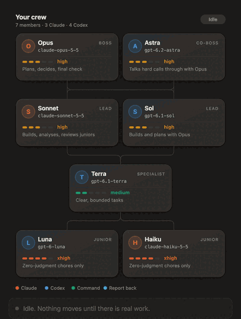

# Claude Codex Crew

Run a team of AI models from Claude Code. The team spans a Claude subscription and a Codex (OpenAI) subscription. A live org chart beside the chat shows who gives work to whom and who reports back, while the work runs.

<p align="center">
  
  <br>
  <sub>A sample run: green lines are commands, blue lines are report-backs. <a href="docs/crew-demo.mp4">Full-quality video (MP4)</a></sub>
</p>

- **One team, two subscriptions.** Claude Code is the boss. It sends routine work to cheaper Claude models through subagents, and to Codex models through `codex exec`. That keeps your Claude usage for the work that needs it.
- **Live org chart.** The Crew panel draws every member as a card with its tier, model and effort. When a member gets work, a green line runs from the member who gave it. When the member finishes, a blue line runs back. Nothing animates while the crew is idle.
- **Routing rules in the system prompt.** The mod tells Claude how to route work: which tier gets which kind of task, which tasks juniors may never get, and that failed work goes up a tier. Claude announces each delegation in one line.
- **Safe service access, for the services you pick.** You choose which of Shopify, PostHog, Supabase and Cloudflare your crew uses. Per service, you choose whether reads run without asking and writes ask you first. On the Codex side, a hook keeps PostHog and Cloudflare read-only.

## The default crew

| Tier | Member | Vendor | Model | Effort | Gets |
| --- | --- | --- | --- | --- | --- |
| 0 CTO | Fable | Claude | claude-fable-5-2 | xhigh | Only problems that the Boss and the Advisor both failed to solve |
| 1 Boss | Opus | Claude | claude-opus-5-5 | high | Planning, decisions and the final check |
| 1 Advisor | Astra | Codex | gpt-6.2-astra | high | Second opinions on risky calls |
| 2 Lead | Sonnet | Claude | claude-sonnet-5-5 | high | Building, analysis, and review of junior work |
| 2 Lead | Sol | Codex | gpt-6.1-sol | high | Building and planning |
| 3 Specialist | Terra | Codex | gpt-6.1-terra | medium | Clear tasks with fixed limits |
| 4 Junior | Luna | Codex | gpt-6-luna | xhigh | Chores that need no decisions |
| 4 Junior | Haiku | Claude | claude-haiku-5-5 | xhigh | Chores that need no decisions |

In the panel you can change each member's model, effort and tier. Your changes are saved across sessions. To restore the defaults, select **Reset crew to defaults**.

## Who did what, in the transcript

The panel shows the crew right now. The transcript keeps the record of who did what, in two kinds of blocks.

**1. A Crew plan, before the work starts.** For any task that uses more than one member or more than one step, Claude posts a plan before the first delegation. If the plan changes along the way, Claude posts an updated one that says what changed. A single quick delegation gets a one-line announcement instead.

> **Crew plan**
>
> | Member | Effort | Does |
> | --- | --- | --- |
> | Opus (Boss) | high | Designs the change and reviews everything; keeps the mod code because it depends on context already loaded |
> | Sol (Codex) | high | Rewrites `install.sh` from a written brief, in its own folder |
> | Sonnet (Claude) | high | Reviews Sol's script against the brief |
> | Luna (Codex) | xhigh | Renames the files Opus listed |

The plan comes from the routing rules in Claude's instructions, so it depends on Claude following them.

**2. A card under every delegation.** The mod draws a card under each Agent call and each `codex exec` call. It shows the member, its vendor, tier, model and effort, the task, and who gave it. The status changes from **Working** to **Reported** with the time taken. A background run stays at Working until it ends.

```text
Bash(codex exec -m gpt-6.1-terra "Run: wc -l install.sh ...")
╭──────────────────────────────────────────────────────────────────────────────╮
│ ● Terra · Codex · Specialist · gpt-6.1-terra · effort medium   ✓ Reported · 24s │
│ Task: Count install.sh lines   From: Opus                                    │
╰──────────────────────────────────────────────────────────────────────────────╯
```

The mod draws these cards from the actual calls, so they appear even when Claude forgets to announce a delegation.

## Requirements

- macOS or Linux, with `bash`, `rsync` and `python3`.
- [Claude Code](https://claude.com/claude-code), in a version that supports mods (plugins with a hooks module). The panel draws in the Claude desktop app and in other surfaces that support panes.
- Optional: the [Codex CLI](https://github.com/openai/codex), signed in. Without Codex, the routing rules send Codex members' work to Claude members, and the chart still shows the whole crew.

## Set up with Claude (recommended)

Paste this into Claude Code. Claude asks which services you use, runs the installer, and finds your connector IDs, so you don't look anything up by hand.

```text
Set up Claude Codex Crew for me from https://github.com/sardapv/claude-codex-crew.

1. Clone it to ~/claude-codex-crew (or pull if it is already there). Read README.md and install.sh before running anything.
2. Ask me which services I use (Shopify, PostHog, Supabase, Cloudflare; any or none) and whether to set up Codex members. Then run:
   ~/claude-codex-crew/install.sh --services <my list, comma separated, or none> --codex <yes|no>
3. Find my connector IDs. For each service I chose, look at the MCP tools connected in this session. A claude.ai connector's tools are named mcp__<connector id>__<tool>. Match each connector to a service by its tools: Shopify has tools like get-shop-info and search_products; Supabase has execute_sql and list_projects; PostHog has exec or query tools; Cloudflare has execute plus search or docs. Skip tools named mcp__plugin_posthog_posthog__* or mcp__plugin_cloudflare_cloudflare__*: the mod already knows those. If a service I chose has no connector in this session, tell me to connect it (/mcp), then continue.
4. Merge what you found into the "connectors" object of ~/.claude/crew.json as "<connector id>": "<service>". Keep every other key and entry. Keep the file mode 600.
5. Show me the final ~/.claude/crew.json and the hand steps the installer printed that still apply to me. Tell me to open a new Claude Code session, where the Crew panel opens by itself.
```

## Set up by hand

```bash
git clone https://github.com/sardapv/claude-codex-crew.git
cd claude-codex-crew
./install.sh
```

The installer asks which services you use and whether to set up Codex members. To skip the questions, pass your answers:

```bash
./install.sh --services supabase,posthog --codex yes   # or --services all / none, --codex no
./install.sh --yes                                      # all services, Codex if it is installed
```

You can run the installer again at any time to change your answers. It backs up every file before it changes it, with a timestamp in the backup's name. It does these things:

1. Copies the mod to `~/.claude/mods/crew`, registers that folder as a local plugin marketplace named `local-mods`, installs `crew@local-mods` for your user, and runs the mod's tests.
2. Adds a short "Crew" section to `~/.claude/CLAUDE.md`. The section tells Claude to keep the panel open and to follow the routing rules.
3. Writes your answers to `~/.claude/crew.json`, a private file that only you can read. If the file already exists, the installer keeps its connector IDs.
4. If you set up Codex and chose PostHog or Cloudflare: copies `crew-guard.py` to `~/.codex/hooks/`. In `~/.codex/config.toml`, it adds the guard hook for those services, plus a setting that lets their reads run without a prompt. For Cloudflare, it also adds the Cloudflare MCP server.

Then do the steps that the installer prints at the end:

1. **Claude:** connect the services you chose (run `/mcp` to see them).
2. **Connector IDs:** add them to `~/.claude/crew.json` (see the next section).
3. **Codex:** run `codex login`, connect your services in Codex, and for Cloudflare run `codex mcp login cloudflare`.
4. **Codex:** start `codex`, open `/hooks` and trust **Crew guard**. Until you trust it, Codex does not run the guard, so writes are not blocked.
5. Open a new Claude Code session. The Crew panel opens by itself. If you close it, type `/crew`.

## ~/.claude/crew.json

This file holds your setup. It stays on your machine and is never part of the repo. The mod reads it each time a session starts.

```json
{
  "services": ["supabase", "posthog"],
  "codex": true,
  "connectors": {
    "00000000-aaaa-0000-0000-000000000000": "supabase",
    "00000000-bbbb-0000-0000-000000000000": "posthog"
  }
}
```

- **`services`**: the services the panel shows and guards. A service that isn't listed gets Claude Code's normal permission prompts. Without this key, the mod uses all four.
- **`codex`**: `false` tells Claude not to delegate to Codex members.
- **`connectors`**: maps each claude.ai connector to its service. Claude names a connector's tools `mcp__<connector id>__<tool>`, and every account has its own IDs. To find an ID, look at the connector's tool names in `/mcp`, or let Claude do it with the prompt above. The official PostHog and Cloudflare plugins need no entry. Without an entry, the mod falls back to the server's name: a server whose name contains "supabase" counts as Supabase.

## Make it yours

The mod is plain TypeScript in `claude/mods/crew/hooks/`. After you install it, edit the live copy in `~/.claude/mods/crew`. To load your changes, run `claude plugin test ~/.claude/mods/crew`, then `/reload-plugins`.

| To change | Edit |
| --- | --- |
| Default members, models, efforts and tiers | `DEFAULTS` in `hooks/register.tsx` |
| The routing rules that Claude gets, including the Crew plan rule | `routingText` and `toolsRule` in `hooks/register.tsx` |
| The card under each delegation | the `ToolUse` render hook in `hooks/register.tsx` |
| What counts as a read or a write | `isRead` in `hooks/permissions.ts`, and `codex/crew-guard.py` for Codex |
| The look of the chart | `hooks/chart.ts` |

To copy your edits back into the repo, run `./sync-from-this-mac.sh`. Then commit.

## How the Codex guard works

`codex/crew-guard.py` is a Codex `PreToolUse` hook. It runs on every call to the services you chose of PostHog and Cloudflare, and allows only calls it can classify as reads:

- **PostHog:** `learn`, `help`, `tools`, `search`, `info` and `schema`, plus `call <tool>` when the tool is a query, get, list, retrieve or search, and the call has no `--confirm`.
- **Cloudflare:** `execute` code that has no POST, PUT, PATCH or DELETE request, and no create, update or delete call.

The guard denies everything else, including calls it can't read or classify. Send writes to a Claude member, where Claude Code asks you first.

To test it:

```bash
echo '{"tool_name":"mcp__cloudflare__execute","tool_input":{"code":"cloudflare.request({method:\"DELETE\"})"}}' \
  | python3 -I ~/.codex/hooks/crew-guard.py; echo "exit $?"   # exit 2 = blocked
```

## Uninstall

```bash
claude plugin uninstall crew@local-mods
claude plugin marketplace remove local-mods
```

Then delete these:

- the "Crew" section in `~/.claude/CLAUDE.md`
- the "Crew" blocks in `~/.codex/config.toml`
- `~/.claude/crew.json`
- the folder `~/.claude/mods/crew`

The installer's backups sit beside each file, with names like `*.bak-crew-<timestamp>`.

## License

MIT. See [LICENSE](LICENSE).
