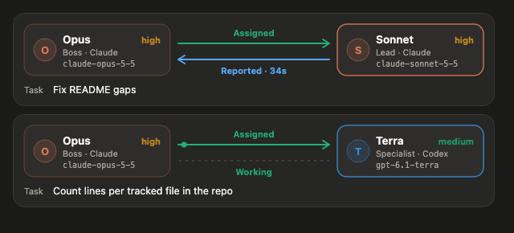

# Who did what, in the transcript

The panel shows the crew right now. The transcript keeps the record of who did what, in two kinds of blocks.

**1. A Crew plan, before the work starts.** For any task that uses more than one member or more than one step, Claude posts a plan before the first delegation. If the plan changes along the way, Claude posts an updated one that says what changed. A single quick delegation gets a one-line announcement instead.

> **Crew plan**
>
> | Member | Effort | Does |
> | --- | --- | --- |
> | Opus (Boss) | high | Designs the change and reviews everything; keeps the mod code because it depends on context already loaded |
> | Sol (Codex) | high | Rewrites `install.sh` from a written brief, in its own folder |
> | Sonnet (Claude) | high | Reviews Sol's script against the brief |
> | Luna (Codex) | xhigh | Renames the files Opus listed |

The plan comes from the routing rules in Claude's instructions, so it depends on Claude following them.

**2. A handoff card under every delegation.** The mod draws a card under each Agent call and each `codex exec` call:

- The left box is the member who gave the task. The right box is the member who got it, with its tier, vendor, model and effort.
- A green arrow shows the task going out, with a dot moving along it while the member works.
- When the member finishes, a blue arrow runs back, labeled with the time taken. A failed or interrupted run gets a red arrow instead.
- A background run stays at Working until it ends.

<p align="center">
  
</p>

In the terminal, the same card is drawn in text:

```text
╭──────────────────────────────────────────────────────────────────────╮
│ [ Opus ] ── assigned ──▶ [ Terra · Specialist · gpt-6.1-terra · medium ] │
│          ◀── ✓ Reported · 11s ──                                      │
│ Task: Count install.sh lines                                         │
╰──────────────────────────────────────────────────────────────────────╯
```

The mod draws these cards from the actual calls, so they appear even when Claude forgets to announce a delegation.
